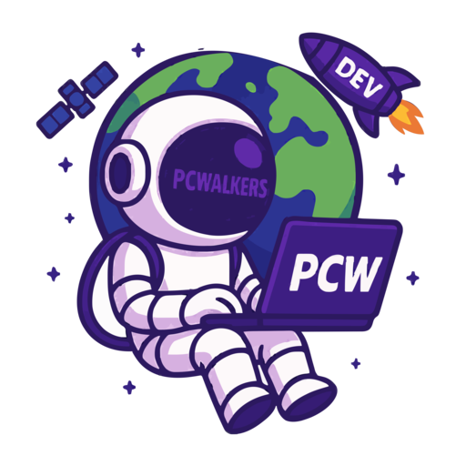

# Pavan Kumar Naraharisetti

<div align="center">




<br/>

<a href="https://pnaraharisetti.netlify.app/"></a>
<a href="https://www.linkedin.com/in/pnaraharisetti"></a>
<a href="https://github.com/PaVaN1063?tab=repositories"></a>

<br/><br/>

`FULL STACK ENGINEERING` &nbsp; · &nbsp; `CREATIVE THINKING` &nbsp; · &nbsp; `CONTINUOUS EVOLUTION`

</div>

---

<div align="center">


</div>

## `01` / THE MIND BEHIND THE MACHINE

```ts
const pavan = {
  name: "Pavan Kumar Naraharisetti",
  role: "Full Stack Developer",
  company: "ITC Infotech",
  location: "Bengaluru, India",
  experience: "4+ years",

  frontend: ["Angular", "React", "Next.js"],
  backend: ["Node.js", "NestJS"],
  languages: ["TypeScript", "JavaScript"],
  cloud: ["Microsoft Azure"],

  philosophy: "Build with purpose. Engineer for impact."
};
```

I engineer modern web applications by connecting thoughtful frontend experiences with dependable backend architecture.

My work spans component-driven UI development, API engineering, real-time communication, and scalable application workflows. I enjoy breaking down complex requirements into software that is maintainable, efficient, and intuitive to use.

- ⚡ Creating responsive, performance-conscious interfaces.
- ⚙️ Engineering modular APIs and backend services.
- 🔄 Exploring event-driven workflows and real-time systems.
- ☁️ Working with cloud platforms and modern deployment practices.
- 🧠 Continuously improving architecture, code quality, and problem-solving.

<div align="center">

**Think beyond the interface. Engineer the entire experience.**

</div>

---

## `02` / THE TECHNOLOGY GALAXY

<div align="center">

### ◈ FRONTEND ENGINEERING


<br/><br/>

### ◈ BACKEND & APPLICATION ARCHITECTURE


<br/><br/>

### ◈ DATA, CLOUD & DEVELOPER TOOLS


<br/><br/>


</div>

---

## `03` / ENGINEERING CAPABILITIES

<table>
<tr>
<td width="50%" valign="top">

###  Frontend Systems

Building clean, responsive, reusable interfaces with modern component-based frameworks.

- Angular and React applications
- Next.js web experiences
- Component architecture
- Responsive UI development
- Frontend performance

</td>
<td width="50%" valign="top">

###  Backend Systems

Developing structured backend services designed for reliability and maintainability.

- REST API development
- NestJS and Node.js
- Modular service architecture
- Database integration
- Asynchronous processing

</td>
</tr>
<tr>
<td width="50%" valign="top">

###  Real-Time Engineering

Working with communication patterns and workflows that keep applications responsive.

- WebSocket communication
- Event-driven workflows
- Live application updates
- Background job processing
- Reliable integrations

</td>
<td width="50%" valign="top">

###  Delivery & Cloud

Supporting modern development workflows from implementation through deployment.

- Microsoft Azure
- Git and GitHub workflows
- Application configuration
- Deployment troubleshooting
- Maintainable delivery practices

</td>
</tr>
</table>

---

## `04` / PROJECT EXPLORER

<div align="center">


*Every project is an opportunity to solve a problem a little better.*

</div>

<table>
<tr>
<td width="50%" valign="top">

### ◈ Project Alpha


A featured web application showcasing frontend engineering, backend integration, and practical problem-solving.

**Technology direction**

`TypeScript` `React` `Node.js`

<a href="https://github.com/PaVaN1063?tab=repositories">↗ Explore repositories</a>

</td>
<td width="50%" valign="top">

### ◈ Project Beta


A backend-oriented project focused on APIs, modular services, data handling, and scalable application workflows.

**Technology direction**

`NestJS` `Node.js` `Database`

<a href="https://github.com/PaVaN1063?tab=repositories">↗ Explore repositories</a>

</td>
</tr>
</table>

<div align="center">

<a href="https://github.com/PaVaN1063?tab=repositories"></a>

</div>

> **Portfolio tip:** Replace Project Alpha and Project Beta with actual repository names, descriptions, and direct links before publishing. These are placeholders, not claims about existing projects.

---

## `05` / HOW I ENGINEER

<div align="center">

<table>
  <tr>
    <td align="center" width="33%">
      <br/>
      
      <br/><br/>
      **Scalable by Design**
      <br/>
      <sub>Building modular, maintainable applications with clean architecture and reusable components.</sub>
      <br/><br/>
    </td>
    <td align="center" width="33%">
      <br/>
      
      <br/><br/>
      **Performance First**
      <br/>
      <sub>Optimizing rendering, API communication, and application responsiveness.</sub>
      <br/><br/>
    </td>
    <td align="center" width="33%">
      <br/>
      
      <br/><br/>
      **End-to-End Thinking**
      <br/>
      <sub>Connecting intuitive frontend experiences with reliable backend services.</sub>
      <br/><br/>
    </td>
  </tr>
</table>

</div>

---

### `THE WORKFLOW`

`01` **Understand** → Define the problem and technical requirements.

`02` **Architect** → Design modular components, APIs, and data flows.

`03` **Build** → Develop type-safe, reusable, production-ready solutions.

`04` **Refine** → Test, optimize, review, and improve.

---


---

## `06` / PROFESSIONAL MILESTONE

<div align="center">


<br/><br/>

**Recognition at Miracle Software Systems**

A meaningful milestone that reflects my professional journey, commitment to delivering quality work, and continued growth as a developer.

</div>

---

## `07` / THE ENGINEERING MINDSET

<table>
<tr>
<td align="center" width="33%">

### ◈ ARCHITECT

<sub>Design for clarity. Build for maintainability. Plan for scale.</sub>

</td>
<td align="center" width="33%">

### ◈ CREATOR

<sub>Turn ideas into useful products with thoughtful experiences.</sub>

</td>
<td align="center" width="33%">

### ◈ PROBLEM SOLVER

<sub>Question assumptions. Simplify complexity. Deliver results.</sub>

</td>
</tr>
</table>

<div align="center">


</div>

---

## `08` / BEYOND THE COMMIT

```text
[01]  Stay curious.
[02]  Learn continuously.
[03]  Write maintainable code.
[04]  Build with purpose.
[05]  Improve with every iteration.
```

<div align="center">

*The goal isn't simply to make software work.*

**It's to make it work well.**

</div>

---

## `09` / LET'S BUILD THE NEXT THING

<div align="center">


### Have an interesting idea, project, or opportunity?

Let's connect, exchange ideas, and build something meaningful.

<br/>

<a href="https://pnaraharisetti.netlify.app/"></a>
<a href="https://www.linkedin.com/in/pnaraharisetti"></a>
<a href="https://github.com/PaVaN1063"></a>

<br/><br/>


<sub>DESIGNED WITH INTENTION · ENGINEERED WITH PURPOSE · POWERED BY CURIOSITY</sub>

</div>
